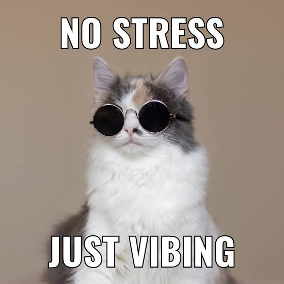

<p align="center">
  <a href="https://github.com/alinasafina22">
    
  </a>
</p>

<p align="center">
  <a href="https://www.linkedin.com/in/alina-zharkevich-759b5b215"></a>
  <a href="https://t.me/safinalina17"></a>
  
</p>

## 💜 About me

```text
🧪  Senior QA Engineer, 5+ years in testing
🔌  Love backend: APIs, databases, message queues — and testing all of it
🐍  Build test frameworks in Python and write backend services with FastAPI
👩‍🏫  Review test code and mentor junior QA engineers
🎮  Off duty: games, music and books
✈️  Travelling and exploring the world in between
```

## 🛠 Skills

<table>
  <tr>
    <td><b>API</b></td>
    <td>
      
      
      
      
    </td>
  </tr>
  <tr>
    <td><b>Automation</b></td>
    <td>
      
      
      
      
      
      
      
    </td>
  </tr>
  <tr>
    <td><b>Data &amp; messaging</b></td>
    <td>
      
      
      
    </td>
  </tr>
  <tr>
    <td><b>CI/CD</b></td>
    <td>
      
    </td>
  </tr>
  <tr>
    <td><b>Backend</b></td>
    <td>
      
    </td>
  </tr>
  <tr>
    <td><b>Process</b></td>
    <td>
      
      
      
      
      
      
      
      
    </td>
  </tr>
  <tr>
    <td><b>AI / ML</b></td>
    <td>
      
      
      
    </td>
  </tr>
</table>

## 🐱 Memes

<p align="center">
  <br/>
  <sub>me after all tests passed ✅</sub>
</p>

## 🎧 On repeat

<p align="center">
  <a href="https://www.youtube.com/watch?v=M3Rr9ngLuZA">
    
  </a><br/>
  <sub><b>Михаил Круг &amp; Slipknot — Владимирский Дуал</b></sub><br/>
  <a href="https://www.youtube.com/watch?v=M3Rr9ngLuZA"></a>
</p>

<details>
<summary><b>🌙 More about me — click to expand</b></summary>
<br/>

### 🎮 Games
- 🕹️ Video games — finding bugs for fun, not for a ticket
- ♟️ Chess — used to play and watch a lot, still up for a game
<!-- - 🕹️ Favorite game: **GAME_NAME** -->

### 📚 Books
- 📖 Used to read a book a week, now mostly on my phone
- 🔖 Always have one in progress
<!-- - ⭐ All-time favorite: **BOOK_TITLE** by AUTHOR -->
<!-- - 🔖 Currently reading: **BOOK_TITLE** -->

### 🎸 Music
- 🎧 On my playlist: Snoop Dogg and Alla Pugacheva (yes, both 😄)
- 🎹 Learning piano and making my first tracks in GarageBand — `status: WIP`
- 🌾 Dream project: lofi hip-hop with Tatar folk vibes (kurai &amp; kubyz)

</details>

## 📊 GitHub activity

<p align="center">
  
  
</p>


